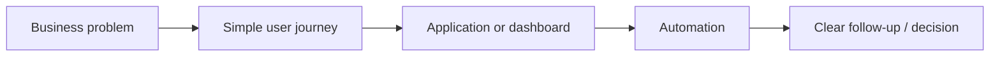
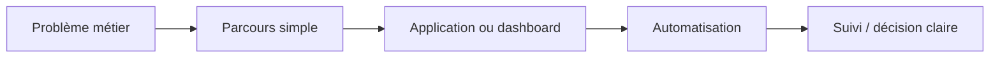

# Jefferson Mawapanga Saku

[Power Platform](https://github.com/jeffersonkuku/jefferson-Mawapanga-Saku) · [Power BI](https://github.com/jeffersonkuku/powerbi-portfolio-projects) · [LinkedIn](https://www.linkedin.com/in/jefferson-mawapanga-saku-604b72191/)

---

## 🇬🇧 English

### What I do — 30 seconds

I turn **manual processes, scattered e-mails and hard-to-read data** into simple business applications, automations and dashboards.

<table>
<tr>
<td width="33%" valign="top">

 <strong>Ticketing & Request Management</strong> 
Requests → right team → status → documents → history.
  <a href="https://github.com/jeffersonkuku/jefferson-Mawapanga-Saku/tree/main/projects/power-platform-ticketing-system"><strong>Open project →</strong></a>
</td>

<td width="33%" valign="top">

 <strong>Building Operations Hub</strong> 
Site → building → equipment → procedure / contact.
  <a href="https://github.com/jeffersonkuku/jefferson-Mawapanga-Saku/tree/main/projects/building-operations-hub"><strong>Open project →</strong></a>
</td>

<td width="33%" valign="top">

 <strong>Procurement Control Tower</strong> 
Budget → spend → commitments → supplier risk.
  <a href="https://github.com/jeffersonkuku/powerbi-portfolio-projects/tree/main/powerbi-procurement-financial-control-tower"><strong>Open project →</strong></a>
</td>
</tr>
</table>

### My approach

Technical details are inside each project, not on this landing page.

---

## 🇫🇷 Français

### Ce que je fais — 30 secondes

Je transforme des **processus manuels, des e-mails dispersés et des données difficiles à lire** en applications métiers, automatisations et tableaux de bord simples.

| Projet | En une phrase |
|---|---|
| **[Ticketing & gestion des demandes](https://github.com/jeffersonkuku/jefferson-Mawapanga-Saku/tree/main/projects/power-platform-ticketing-system)** | Une demande va vers la bonne équipe avec statut, documents et historique |
| **[Building Operations Hub](https://github.com/jeffersonkuku/jefferson-Mawapanga-Saku/tree/main/projects/building-operations-hub)** | Le technicien suit le site jusqu’au bon équipement puis ouvre la bonne procédure |
| **[Procurement Control Tower](https://github.com/jeffersonkuku/powerbi-portfolio-projects/tree/main/powerbi-procurement-financial-control-tower)** | Le manager voit budget, dépenses, engagements et risques au même endroit |

Les détails techniques sont disponibles seulement après ouverture d’un projet.
