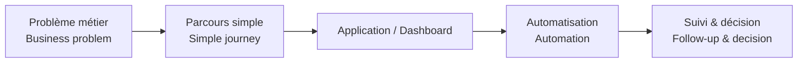
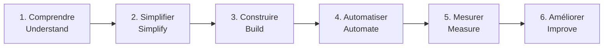

# Jefferson Mawapanga Saku

> 🇫🇷 **Je transforme des processus métiers complexes en applications, automatisations et tableaux de bord simples à utiliser.**  
> *🇬🇧 I turn complex business processes into simple applications, automations and dashboards.*

[⚡ Power Platform](https://github.com/jeffersonkuku/jefferson-Mawapanga-Saku) · [📊 Power BI](https://github.com/jeffersonkuku/powerbi-portfolio-projects) · [💼 LinkedIn](https://www.linkedin.com/in/jefferson-mawapanga-saku-604b72191/)

---

## 👋 En 30 secondes / In 30 seconds

🇫🇷 Mon objectif n’est pas seulement de créer une application ou un dashboard : je cherche à **rendre un processus plus clair, plus rapide et plus facile à suivre**.  
*🇬🇧 My goal is not only to build an app or dashboard: I aim to **make a process clearer, faster and easier to follow**.*

## 🧩 Tous mes projets / All my projects

🇫🇷 Chaque carte résume **le problème**, **la solution** et **le fonctionnement**. Clique ensuite sur le projet pour voir l’explication complète image par image.  
*🇬🇧 Each card summarises **the problem**, **the solution** and **how it works**. Open a project to see the full image-by-image walkthrough.*

<table>
<tr>
<td width="33%" valign="top">

 <strong>Ticketing & Request Management</strong>
 🇫🇷 Centraliser une demande, son responsable, ses documents, ses e-mails et son historique.
 <em>🇬🇧 Centralise a request, its owner, documents, e-mails and history.</em>
  <code>Demande → équipe → traitement → historique / Request → team → processing → history</code>
  <a href="https://github.com/jeffersonkuku/jefferson-Mawapanga-Saku/tree/main/projects/power-platform-ticketing-system"><strong>Voir le projet / Open project →</strong></a> <a href="https://www.youtube.com/watch?v=_jR8T9s2VUE">▶ Démo / Demo</a>
</td>
<td width="33%" valign="top">

 <strong>Building Operations Hub</strong>
 🇫🇷 Guider un technicien jusqu’à la bonne procédure ou au bon contact terrain.
 <em>🇬🇧 Guide a technician to the right field procedure or contact.</em>
  <code>Site → bâtiment → zone → équipement → action / Site → building → zone → equipment → action</code>
  <a href="https://github.com/jeffersonkuku/jefferson-Mawapanga-Saku/tree/main/projects/building-operations-hub"><strong>Voir le projet / Open project →</strong></a> <a href="https://www.youtube.com/watch?v=Y15BCn_i-fo">▶ Démo / Demo</a>
</td>
<td width="33%" valign="top">

 <strong>Procurement & Financial Control Tower</strong>
 🇫🇷 Réunir budget, dépenses, engagements et risques fournisseurs dans un cockpit.
 <em>🇬🇧 Bring budget, spend, commitments and supplier risk into one cockpit.</em>
  <code>Données → KPI → exceptions → décision / Data → KPIs → exceptions → decision</code>
  <a href="https://github.com/jeffersonkuku/powerbi-portfolio-projects/tree/main/powerbi-procurement-financial-control-tower"><strong>Voir le projet / Open project →</strong></a>
</td>
</tr>
<tr>
<td width="33%" valign="top">

 <strong>SLA & Penalties Operations</strong>
 🇫🇷 Mesurer les délais, le backlog et le risque SLA sans masquer les cas extrêmes.
 <em>🇬🇧 Measure delays, backlog and SLA risk without hiding extreme cases.</em>
  <code>Interventions → SLA → écarts → risque / Work orders → SLA → gaps → risk</code>
  <a href="https://github.com/jeffersonkuku/powerbi-portfolio-projects/tree/main/powerbi-sla-penalties-portfolio"><strong>Voir le projet / Open project →</strong></a>
</td>
<td width="33%" valign="top">

 <strong>P2 Financial Monitoring</strong>
 🇫🇷 Comparer commandes, factures, sous-traitance et budgets dans un même suivi.
 <em>🇬🇧 Compare orders, invoices, subcontracting and budgets in one monitoring view.</em>
  <code>Commandé → facturé → consommé → restant / Ordered → invoiced → consumed → remaining</code>
  <a href="https://github.com/jeffersonkuku/powerbi-portfolio-projects/tree/main/powerbi-p2-consumables-financial-monitoring"><strong>Voir le projet / Open project →</strong></a>
</td>
<td width="33%" valign="top">

 <strong>Financial Pilotage</strong>
 🇫🇷 Passer de la vision financière globale jusqu’au détail de la commande.
 <em>🇬🇧 Move from the financial overview down to individual purchase-order detail.</em>
  <code>Budget → fournisseurs → commandes → détail / Budget → suppliers → orders → detail</code>
  <a href="https://github.com/jeffersonkuku/powerbi-portfolio-projects/tree/main/powerbi-financial-pilotage-portfolio"><strong>Voir le projet / Open project →</strong></a>
</td>
</tr>
<tr>
<td width="33%" valign="top">

 <strong>Procurement & Budget</strong>
 🇫🇷 Suivre la consommation budgétaire et les commandes récentes ou récurrentes.
 <em>🇬🇧 Track budget consumption and recent or recurring purchase orders.</em>
  <code>Budget → commandes → consommé → restant / Budget → orders → consumed → remaining</code>
  <a href="https://github.com/jeffersonkuku/powerbi-portfolio-projects/tree/main/powerbi-procurement-budget-portfolio"><strong>Voir le projet / Open project →</strong></a>
</td>
<td width="33%" valign="top">

 <strong>RoadWords AU</strong>
 🇫🇷 Apprendre du vocabulaire en commençant par une vraie prononciation australienne.
 <em>🇬🇧 Learn vocabulary by starting with real Australian pronunciation.</em>
  <code>Écouter → comprendre → répéter → réviser / Listen → understand → repeat → review</code>
  <a href="https://github.com/jeffersonkuku/jefferson-Mawapanga-Saku/tree/main/roadwords-au"><strong>Voir le projet / Open project →</strong></a>
</td>
<td width="33%" valign="top">

 <strong>Native English Coach</strong>
 🇫🇷 Travailler les blocs d’anglais natif par l’écoute, le contexte et la répétition.
 <em>🇬🇧 Practise native-English chunks through listening, context and repetition.</em>
  <code>Écouter → contexte → répéter → automatiser / Listen → context → repeat → automate</code>
  <a href="https://github.com/jeffersonkuku/jefferson-Mawapanga-Saku/tree/main/native-english-coach"><strong>Voir le projet / Open project →</strong></a>
</td>
</tr>

</table>

---

## 🛠️ Comment je construis une solution / How I build a solution

🇫🇷 Les pages projets détaillent ensuite l’architecture, les automatisations, la gestion des accès, les KPI et les choix techniques.  
*🇬🇧 Project pages then explain architecture, automation, access management, KPIs and technical choices.*

**Power Apps · Power Automate · SharePoint · Microsoft 365 · Power BI · Power Query · DAX**
