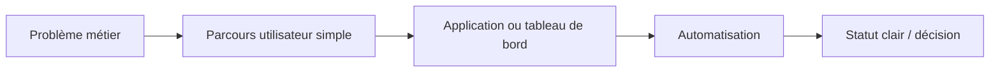

# Jefferson Mawapanga Saku

[Power Platform](https://github.com/jeffersonkuku/jefferson-Mawapanga-Saku) · [Power BI](https://github.com/jeffersonkuku/powerbi-portfolio-projects) · [LinkedIn](https://www.linkedin.com/in/jefferson-mawapanga-saku-604b72191/)

---

## 🇬🇧 English

### What I do — 30 seconds

I turn **manual processes, scattered e-mails and hard-to-read data** into simple business applications, automations and dashboards.

### Featured projects

#### 1. Ticketing & Request Management

**Problem:** requests get lost between e-mails, documents and several teams.  
**Solution:** one application to create, assign, follow and close a request.

**[Open the project →](https://github.com/jeffersonkuku/jefferson-Mawapanga-Saku/tree/main/projects/power-platform-ticketing-system)** · **[Watch the demo →](https://www.youtube.com/watch?v=_jR8T9s2VUE)**

#### 2. Building Operations Hub

**Problem:** technicians lose time looking for the right procedure or contact.  
**Solution:** one field application organised around the real equipment journey.

**Site → Building → Zone → Equipment → Action**

**[Open the project →](https://github.com/jeffersonkuku/jefferson-Mawapanga-Saku/tree/main/projects/building-operations-hub)** · **[Watch the demo →](https://www.youtube.com/watch?v=Y15BCn_i-fo)**

#### 3. Procurement & Financial Control Tower

**Problem:** budget, spend, commitments and supplier risk are split across several views.  
**Solution:** one Power BI cockpit for fast management decisions.

**[Open the project →](https://github.com/jeffersonkuku/powerbi-portfolio-projects/tree/main/powerbi-procurement-financial-control-tower)**

---

## 🇫🇷 Français

### Ce que je fais — 30 secondes

Je transforme des **processus manuels, des e-mails dispersés et des données difficiles à lire** en applications métiers, automatisations et tableaux de bord simples.

### Projets principaux

#### 1. Ticketing & gestion des demandes

**Problème :** les demandes se perdent entre les e-mails, les documents et plusieurs équipes.  
**Solution :** une seule application pour créer, affecter, suivre et clôturer une demande.

**[Voir le projet →](https://github.com/jeffersonkuku/jefferson-Mawapanga-Saku/tree/main/projects/power-platform-ticketing-system)** · **[Voir la vidéo →](https://www.youtube.com/watch?v=_jR8T9s2VUE)**

#### 2. Building Operations Hub

**Problème :** les techniciens perdent du temps à chercher la bonne procédure ou le bon contact.  
**Solution :** une application terrain structurée comme le parcours réel de l’équipement.

**Site → Bâtiment → Zone → Équipement → Action**

**[Voir le projet →](https://github.com/jeffersonkuku/jefferson-Mawapanga-Saku/tree/main/projects/building-operations-hub)** · **[Voir la vidéo →](https://www.youtube.com/watch?v=Y15BCn_i-fo)**

#### 3. Procurement & Financial Control Tower

**Problème :** budget, dépenses, engagements et risques fournisseurs sont répartis dans plusieurs vues.  
**Solution :** un cockpit Power BI unique pour décider rapidement.

**[Voir le projet →](https://github.com/jeffersonkuku/powerbi-portfolio-projects/tree/main/powerbi-procurement-financial-control-tower)**

---

**Power Apps · Power Automate · SharePoint · Microsoft 365 · Power BI · Power Query · DAX**
